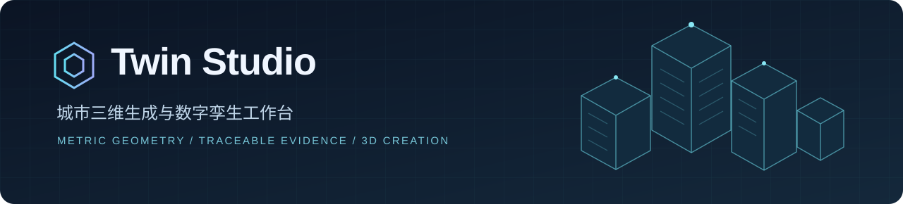
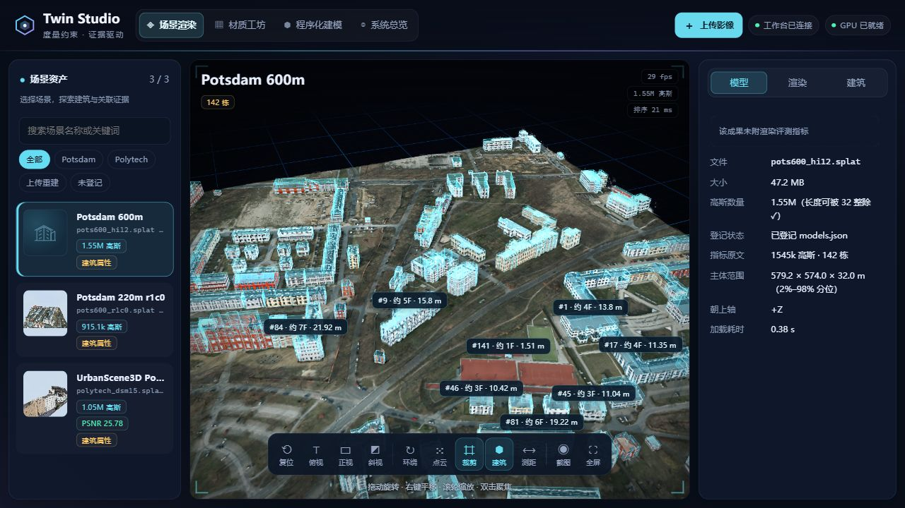
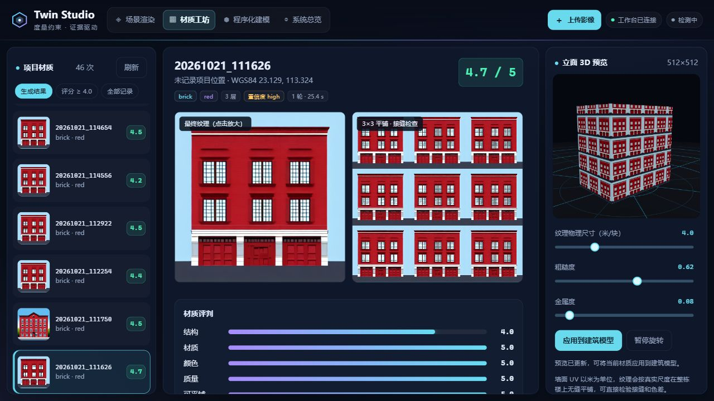
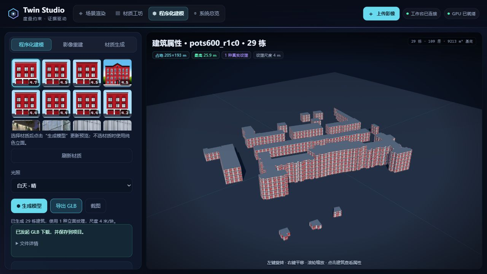
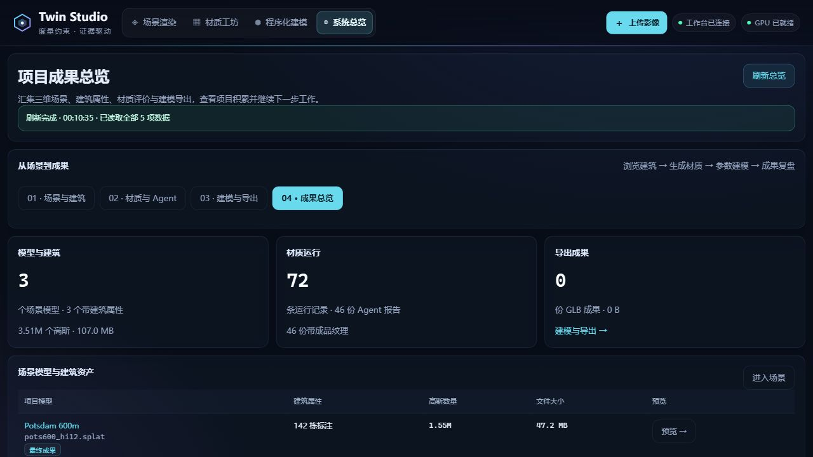
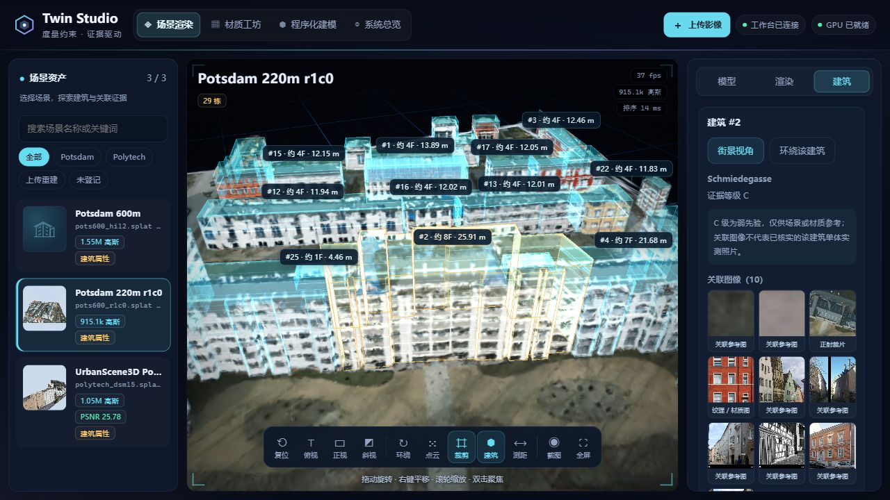

  
  
<strong>度量约束 · 证据驱动 · 三维一致性</strong>

  
把场景浏览、建筑证据、立面材质和程序化建模，连接在同一个工作台中。

  

    
    
    
    
    
  

  
<a href="#界面预览">界面预览</a> · <a href="#核心能力">核心能力</a> · <a href="#快速开始">快速开始</a> · <a href="docs/GETTING_STARTED.md">数据接入与部署</a>

---

## 项目简介

**Twin Studio** 是面向城市三维建模与数字孪生展示的开源工作台。它将 Gaussian Splatting 场景、可查看来源的建筑证据、材质生成与评审、参数化城市建模整合为四个相互衔接的页面。

项目关注的不只是“看见一个模型”，还包括**理解建筑属性、追溯参考依据、检查材质质量，以及导出可继续使用的三维资产**。

## 界面预览

<table>
  <tr>
    <td width="50%" align="center" valign="top">
      <h3>01 · 场景渲染</h3>
      
      
多视角浏览 · 建筑叠加 · 空间测量

    </td>
    <td width="50%" align="center" valign="top">
      <h3>02 · 材质工坊</h3>
      
      
候选对比 · 接缝检查 · 三维材质预览

    </td>
  </tr>
  <tr>
    <td width="50%" align="center" valign="top">
      <h3>03 · 程序化建模</h3>
      
      
轮廓驱动 · 影像上传 · GLB 导出

    </td>
    <td width="50%" align="center" valign="top">
      <h3>04 · 系统总览</h3>
      
      
资产统计 · 质量回顾 · 运行状态

    </td>
  </tr>
</table>

  
<strong>展开查看：建筑证据与来源追溯</strong>

  

点击截图查看原图。以上为系统实际运行截图；配套场景数据、证据包与模型权重不包含在源码仓库中。

## 核心能力

| 模块 | 能做什么 |
| :--- | :--- |
| **场景渲染** | 流式加载 .splat，Web Worker 深度排序，视角切换、点云模式、裁剪、测距、截图；建筑标签避让与属性检查。 |
| **建筑证据** | 关联建筑名称、证据等级、图像和来源记录；区分参考线索、弱先验与估算字段，保留原始记录供追溯。 |
| **材质工坊** | 浏览生成结果与候选图，查看结构、颜色和可平铺性评价；3×3 接缝预览、物理尺寸调整、PBR 预览，一键应用到建筑。 |
| **程序化建模** | 使用建筑轮廓或参数化街区生成建筑，按米制尺度平铺材质，切换日景/黄昏/夜景，导出 GLB。 |
| **影像处理** | 上传影像与可选 DSM，检查格式、显示进度、取消任务、浏览结果；支持已有远端重建服务的适配。 |
| **材质 Agent** | 集成取证 → 校正 → 提示词 → 候选生成 → 评价 → 修订 → 报告的源码流程，支持运行记忆。 |
| **项目总览** | 汇集场景、材质、导出及评价记录，按真实返回结果呈现状态；诊断信息按需展开。 |

### 从输入到交付

~~~mermaid
flowchart LR
    A[影像 + 可选 DSM] --> B[几何 / 高斯面元构建]
    C[已有 .splat 场景] --> D[场景渲染与建筑检查]
    B --> D
    E[参考图像与来源记录] --> F[材质 Agent 与质量评审]
    F --> G[程序化建模]
    D --> G
    G --> H[GLB 资产交付]
~~~

**能力边界：**影像/DSM 内置处理采用地表、屋顶及立面面元构建，并非 SfM 或光度 3DGS 训练；仅影像输入不会推断真实建筑高度。材质生成需要自行配置权重、GPU 和相关 API。界面不会把缺失依赖显示为生成成功。

## 快速开始

### 1. 启动工作台

准备 **Python 3.10+** 和支持 **WebGL2** 的浏览器。核心工作台无需安装 Python 第三方包，也无需前端构建。

~~~bash
git clone https://github.com/anticipate218/twin-studio.git
cd twin-studio
python tools/create_demo.py
python server.py --open
~~~

打开 **http://127.0.0.1:8090/**。macOS/Linux 如果没有 python 命令，可改用 python3。

示例脚本生成一个 **12 栋建筑的合成场景**，帮助首次运行时立即体验模型浏览和建筑选择。它不是实测数据，也没有伪造证据或评测分数。已存在的示例不会被覆盖。

### 2. 启用影像 / DSM 处理

~~~bash
python -m venv .venv
# Windows: .venv\Scripts\activate
# macOS/Linux: source .venv/bin/activate
python -m pip install -r requirements.txt
python server.py --open
~~~

在顶部点击 **上传影像**，选择影像与可选 DSM。上传生成的结果会加入模型库；没有 DSM 时明确标为平坦地表结果。

### 3. 使用自己的数据与材质模型

- .splat 模型放到 data/library/models/，可配合同名 .buildings.json。
- 用 data/library/models.json 补充场景名称和预览；兼容成果证据包可通过 TWIN_FINA 接入。
- 材质 Agent 源码位于 material_agent/，配置模板是 material_agent/config.example.json。
- 权重、真实 API 密钥和运行数据不会进入版本控制。

完整字段、目录结构、环境变量和材质模型配置见 **[启动与数据接入](docs/GETTING_STARTED.md)**。

## 工程结构

~~~text
twin-studio/
├── server.py                 # HTTP 服务、资产与任务接口
├── recon_local.py            # 影像 / DSM 面元构建
├── static/
│   ├── index.html            # 统一工作台入口
│   ├── css/                  # 深色视觉与响应式布局
│   └── js/                   # 四模块交互与 Gaussian Splatting 渲染器
├── material_agent/           # 取证、生成、评审与迭代源码
├── vendor/three/             # 前端依赖与原始许可
├── tools/                    # 合成示例、检查与测试工具
├── tests/                    # 前后端回归测试
└── docs/                     # 配置文档与界面截图
~~~

## 测试

~~~bash
node --test tests/*.mjs
python -m unittest discover -s tests -p "test_*.py" -v
python tools/check_release.py
~~~

Node.js 24 用于开发测试，运行工作台本身不需要 Node.js。CI 在 Windows / Ubuntu、Python 3.10 / 3.12 上执行测试。回归覆盖异步切换、标签布局、参数校验、上传取消、生成入口、GLB 导出及合成示例；真实 GPU 训练不属于 CI 验证范围。

## 作者与许可

**开发与维护：[@anticipate218](https://github.com/anticipate218)**

原创源码采用 **[MIT License](LICENSE)**。第三方依赖与算法参考的许可说明见 **[THIRD_PARTY_NOTICES.md](THIRD_PARTY_NOTICES.md)**；模型权重和数据遵循各自的许可。

Twin Studio · 从城市影像，到可查看、可追溯、可交付的三维场景。

